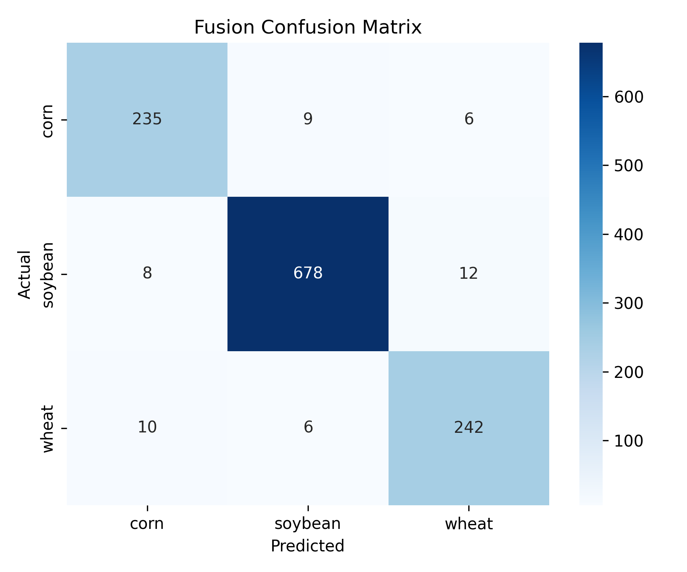
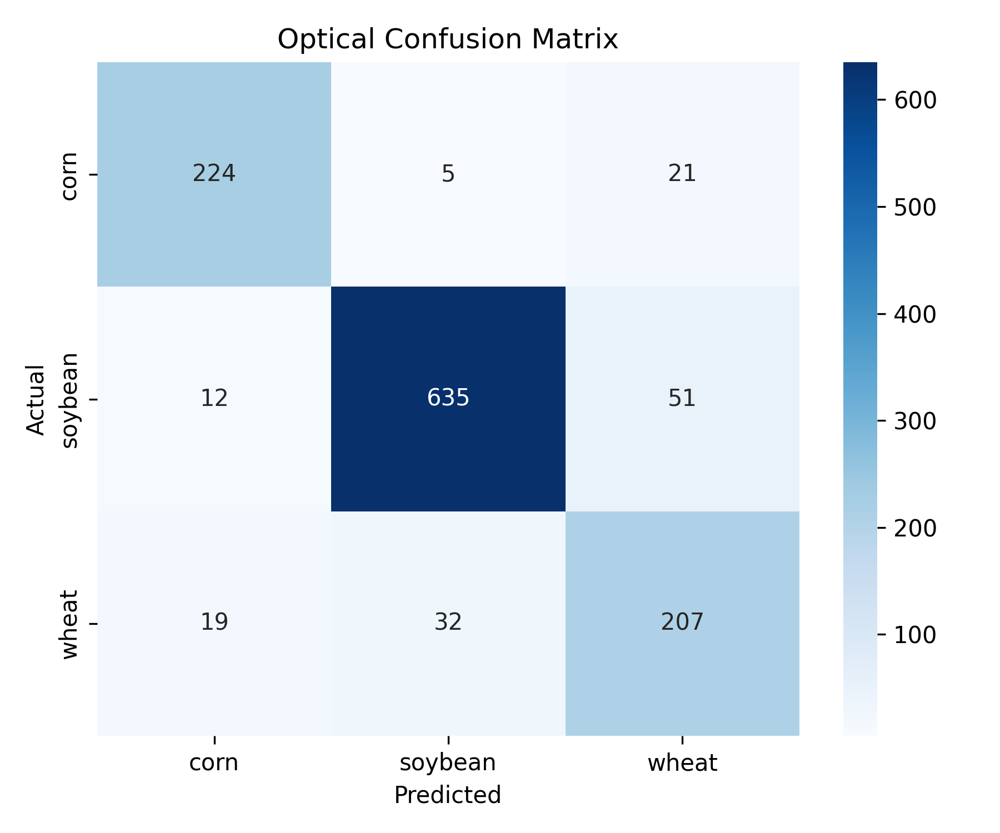
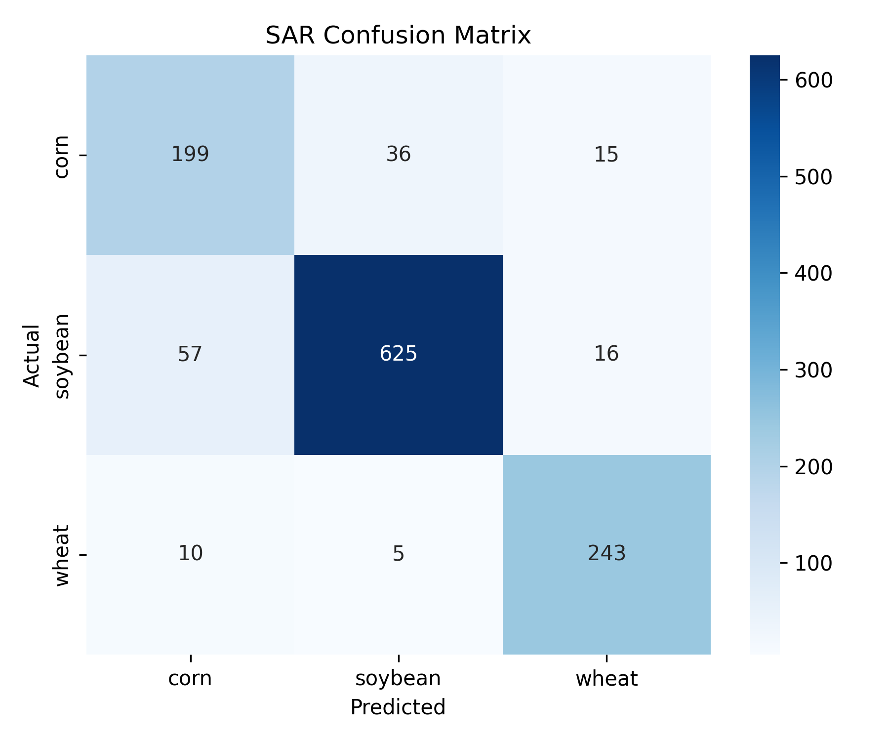
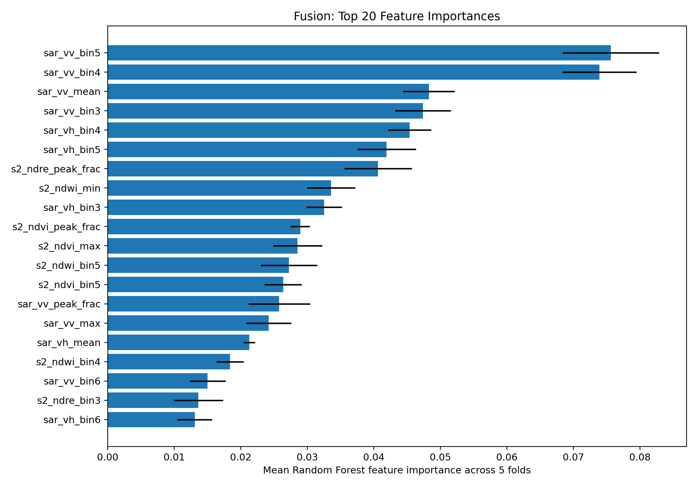
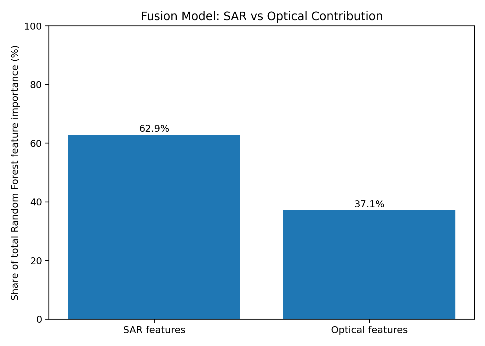

# SAR - Optical Feature Fusion for Crop Type Classification

**Multimodal Remote Sensing \| Agricultural Computer Vision \| Machine
Learning**

## Overview

Crop type classification using satellite imagery supports agricultural
monitoring, land-use analysis, and precision agriculture. Optical and
Synthetic Aperture Radar (SAR) imagery capture complementary
characteristics of the Earth's surface.

This project develops a multimodal, feature-based classification
pipeline combining **Sentinel-2 optical features** and **Sentinel-1 SAR
features** to classify **Corn, Soybean, and Wheat**.

## Objectives

-   Extract Sentinel-2 optical features and vegetation indices.
-   Process Sentinel-1 SAR imagery using VV and VH polarization bands.
-   Integrate complementary optical and SAR features.
-   Compare SAR-only, Optical-only, and SAR--Optical Fusion approaches.
-   Evaluate machine learning models using spatial cross-validation.
-   Analyse feature importance and modality contributions.

## Methodology

The project follows a feature-level fusion approach.

``` text
          YieldSAT Dataset
       (Field Samples and Labels)
                  |
          Data Preprocessing
                  |
          +-------+-------+
          |               |
      Sentinel-2      Sentinel-1
       Optical           SAR
          |               |
     NDVI, NDRE,       VV, VH and
        NDWI          Derived Features
          |               |
          +-------+-------+
                  |
          Feature Integration
                  |
          SAR–Optical Fusion
                  |
        Machine Learning Models
                  |
       Spatial Cross-Validation
                  |
       Performance Evaluation
```

### Optical Feature Extraction

Sentinel-2 imagery was used to derive NDVI, NDRE, and NDWI.

NDVI was calculated using the red (B04) and near-infrared (B08) bands:

$$
NDVI = \frac{B08-B04}{B08+B04}
$$

### SAR Feature Extraction

Sentinel-1 GRD imagery was accessed through Google Earth Engine using
the `COPERNICUS/S1_GRD` dataset. The workflow included IW acquisition
mode filtering, VV and VH polarization selection, consistent orbit
direction filtering, date-based filtering, median compositing, and
field-level backscatter feature extraction.

Additional derived radar features represent relationships between VV and
VH polarization responses.

### Feature Fusion

Optical and SAR features were integrated at the field level using
matching field identifiers.

  Feature Group     Number of Features
  --------------- --------------------
  Optical                           36
  SAR                               42
  **Fused**                     **78**

## Dataset

The experiments use YieldSAT-derived agricultural field samples from
Argentina and Brazil.

  Attribute                  Description
  -------------------------- ----------------------
  Total fields               1,206
  Countries                  Argentina and Brazil
  Crop classes               Corn, Soybean, Wheat
  Time period                2017--2024
  Spatial blocks             76
  Spatial validation folds   5

## Machine Learning Models

Four classification algorithms were evaluated:

-   Logistic Regression
-   Random Forest
-   Support Vector Machine (RBF Kernel)
-   XGBoost

All three feature approaches were evaluated using the same five-fold
spatial cross-validation strategy. Median imputation was incorporated
into the model pipelines to handle missing optical feature values within
the training process.

## Results and Performance Evaluation

The following table presents the Macro-F1 scores obtained by each
classifier.

  Model                   SAR-only   Optical-only      Fusion
  --------------------- ---------- -------------- -----------
  Logistic Regression        0.847          0.862   **0.948**
  Random Forest              0.835          0.717   **0.881**
  SVM (RBF)                  0.867          0.815   **0.914**
  XGBoost                    0.848          0.790   **0.903**

### Best Model Performance

The Fusion approach with Logistic Regression achieved the highest
overall performance.

  Metric              Result
  ----------------- --------
  Accuracy            95.77%
  Macro Precision     95.40%
  Macro Recall        95.00%
  Macro-F1            94.79%
  Weighted-F1         95.80%

### Feature Contribution Analysis

The Random Forest Fusion feature importance analysis indicated the
following modality contributions:

  Modality     Feature Contribution
  ---------- ----------------------
  SAR                           63%
  Optical                       37%

These values represent model-based feature importance and should be
interpreted as exploratory contributions rather than causal effects.

### Statistical Significance

McNemar's test was used to compare paired classification predictions
across the three feature approaches.

-   12 paired comparisons were performed across the four classifiers.
-   11 comparisons showed statistically significant differences at the unadjusted p less than 0.05 level.
-   The only non-significant comparison was SAR versus Optical using
    Logistic Regression (p = 0.1604).
-   Fusion showed statistically significant improvements over both
    individual modalities across all four classifiers.

## Visual Results

The `Results/` directory contains analysis outputs and visualizations,
including crop-wise dataset distribution, country-wise and seasonal
distribution, spatial field distribution, cross-validation fold balance,
feature importance, modality contribution, accuracy and Macro-F1
comparisons, and classification confusion matrices.

### Key Visualizations

### Key Visualizations

**1. Fusion Confusion Matrix**



**2. Optical Confusion Matrix**



**3. SAR Confusion Matrix**



**4. Fusion Feature Importance**



**5. SAR and Optical Contribution**



- For detailed experimental results, feature-level analysis, and additional visualizations, refer to the `Results/` directory.


## Technology Stack

  Category                    Tools and Technologies
  --------------------------- --------------------------------
  Programming Language        Python
  Data Processing             NumPy, Pandas
  Machine Learning            Scikit-learn, XGBoost
  Satellite Data Processing   Google Earth Engine
  Remote Sensing Data         Sentinel-1, Sentinel-2
  Geospatial Processing       Rasterio
  Visualization               Matplotlib
  Development Environment     Google Colab, Jupyter Notebook
  Version Control             Git, GitHub

## Repository Structure

``` text
├── Codes/
│   ├── SAR_Optical_Feature_Fusion.ipynb
│   ├── SAR_Optical_Integrated_Pipeline.ipynb
│   ├── Alignment_Code.ipynb
│   ├── Optical_Features.ipynb
│   ├── Data_Analysis.ipynb
│   ├── evaluation.py
│   └── Supporting scripts and documentation
│
├── Literature_Review/
│   └── papers/
│
├── Results/
│   ├── SAR_Analysis/
│   └── Analysis outputs, CSVs and visualizations
│
├── Reports/
│   └── Week 1–8 reports
│
├── Mid_Sem_Report/
│   └── Group-11_Mid_Sem_Report.pdf
│
├── End_Sem_Report/
│   └── Group-11_End_Sem_Report.pdf
│
└── README.md
```

## Getting Started

1.  Clone the repository:

    ``` bash
    git clone https://github.com/Priyanshi2812/DIP_2026_19_11.git
    cd DIP_2026_19_11
    ```

2.  Install the required dependencies:

    ``` bash
    pip install numpy pandas matplotlib scikit-learn rasterio xgboost
    ```

3.  Open the consolidated Jupyter notebook in Google Colab or Jupyter
    Notebook.

4.  Configure the input dataset paths and Google Earth Engine access
    where required.

5.  Execute the notebook cells to reproduce feature preparation, model
    evaluation, and analysis.

**Data availability:** The complete YieldSAT dataset and original
satellite imagery are not redistributed in this repository. Access to
the required source data and metadata is necessary to reproduce the
complete workflow.

## Limitations

-   Imbalanced crop distribution, with soybean representing the largest
    class.
-   Uneven geographic distribution of fields across Argentina and
    Brazil.
-   Temporal and seasonal variations across the dataset.
-   Missing or invalid field geometries and unavailable SAR acquisitions
    for some samples.
-   Results are based on five-fold spatial cross-validation and may vary
    with different spatial partitions.

## Conclusion

This project demonstrates the application of multimodal satellite
feature fusion for agricultural crop type classification.

The integration of Sentinel-1 SAR and Sentinel-2 optical features
improved classification performance compared with individual feature
approaches. The Fusion Logistic Regression model achieved **95.77%
accuracy** and **94.79% Macro-F1**, highlighting the value of combining
complementary remote-sensing information.

The project provides a feature-based machine learning pipeline for
analysing agricultural satellite data and classifying major crop types.

## Project Background

Originally developed as a Digital Image Processing (DIP) project, this
work explores the intersection of remote sensing, machine learning, and
agricultural computer vision.
